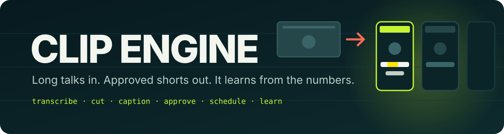
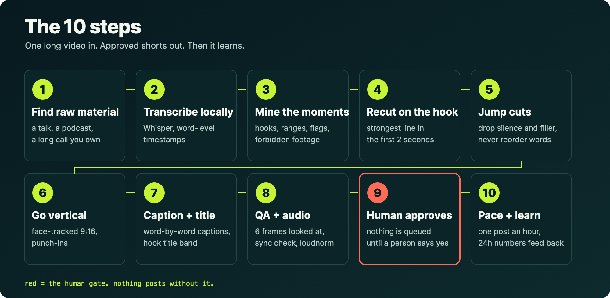
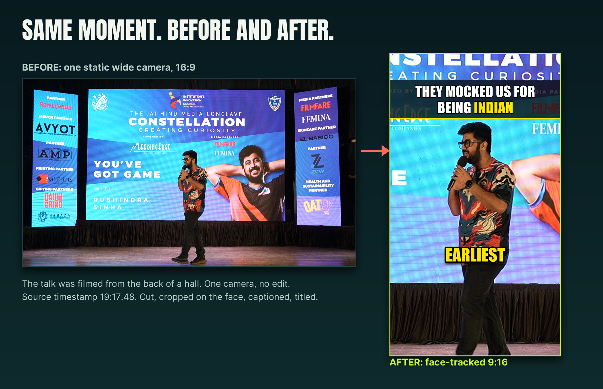
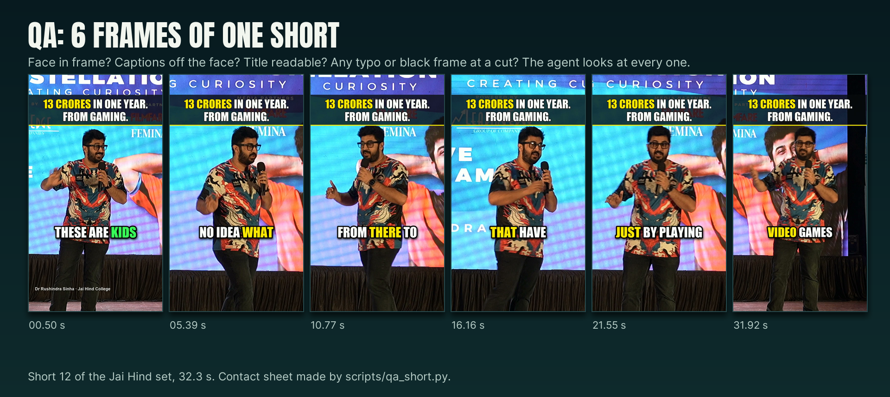
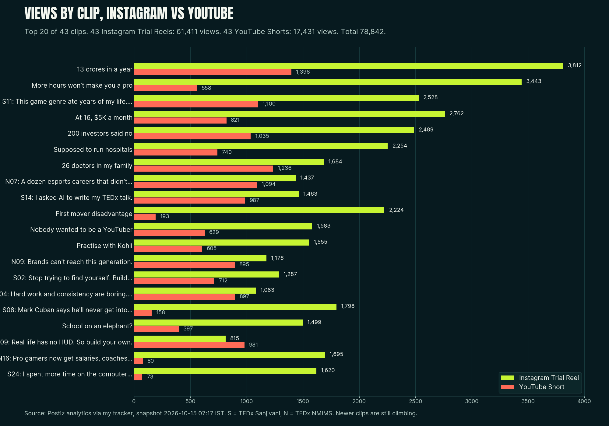

<p align="center">
  
</p>

<h1 align="center">Clip Engine</h1>

<p align="center">
  <strong>Turn a long talk, podcast or interview into captioned vertical shorts, get them approved, post them one an hour, and learn from the numbers after 24 hours.</strong><br>
  A skill for your AI agent, plus plain scripts you can run yourself.
</p>

<p align="center">
  <a href="LICENSE"></a>
  
  
  
  
</p>

<p align="center">
  <a href="#install">Install</a> ·
  <a href="#use">Use</a> ·
  <a href="#how-it-works">How it works</a> ·
  <a href="#a-real-run">A real run</a> ·
  <a href="#rules-that-never-bend">Rules</a> ·
  <a href="PORTABLE_PROMPT.md">Portable prompt</a>
</p>

---

> [!NOTE]
> **This is not a stream clipper.** It does not find highlights in live streams or VODs from chat spikes or audio peaks. It is for long talking footage you already own (talks, podcasts, interviews, lectures) and it turns it into vertical shorts you approve, schedule and measure.

## 30 seconds

```text
you     cut this talk into shorts

agent   transcribes it locally (word timestamps), reads all 51 minutes, and sends you a content pack:
        12 candidate moments, each with the hook line, the time range, flags (a regulator is named,
        a number needs clearing), and 3 words Whisper got wrong that it will fix.

you     good, do 1 to 12

agent   renders 12 vertical shorts: jump cuts, face-tracked 9:16, word-by-word captions, a hook title,
        clean audio. Pulls 6 frames from every short and looks at them. Re-transcribes the output to
        check caption timing. Writes titles and captions in your voice.
        Contact sheets and copy are in the folder. Which are approved?

you     approve all

agent   queues them one an hour: Instagram as Trial Reels, YouTube Shorts in the same slot.
        24 hours after each post it reads the numbers and writes down what it thinks won.
```

Nothing is queued before you say which are approved. Nothing posts faster than one an hour.

## Why

Most people's best content is already recorded. A talk, a podcast, a long call. It sits in a folder. Cutting it by hand is two hours a clip, so it never happens.

This is the setup I used on a real two-year-old talk: [one night, 12 shorts, then 86 posts over two days](#a-real-run). It is open here because the interesting part is not the video editing. It is the order of operations that made it safe to run while I slept: human approval, visual QA, slow posting, and a loop that reads the results.

## Install

Works with any agent that reads `SKILL.md` style skill files: Claude Code, OpenClaw, Codex, Cursor, Windsurf, or anything with a skills directory. Python 3.9 or newer.

```bash
git clone https://github.com/rushindrasinha/clip-engine.git

# Claude Code (global)
cp -r clip-engine/skill/talk-clip-engine ~/.claude/skills/talk-clip-engine

# OpenClaw, or any workspace with a skills directory
cp -r clip-engine/skill/talk-clip-engine <your-workspace>/skills/talk-clip-engine

# Codex, Cursor or an agent without skills: point your AGENTS.md / .cursor/rules at
#   clip-engine/skill/talk-clip-engine/SKILL.md  and keep the scripts/ folder next to it.
```

Dependencies:

```bash
pip install numpy opencv-python pillow
pip install mlx-whisper        # Apple Silicon.  Elsewhere: pip install openai-whisper
# ffmpeg and ffprobe on your PATH
npm i -g postiz                # optional, only for the scheduling step
```

No agent with a skills directory? Paste [`PORTABLE_PROMPT.md`](PORTABLE_PROMPT.md) into any chat model and it runs the same method in the conversation.

## Use

Say any of these to your agent:

| Say | What happens |
|---|---|
| `cut this talk into shorts` | transcribe, mine, send a content pack |
| `clip engine this` | same, for the file or link you point at |
| `turn this video into reels/shorts` | same, with Reels and Shorts copy |
| `schedule the approved ones` | queue plan, dry run, then create |
| `how did the shorts do` | snapshot, leaderboard, learnings draft |

Or run the scripts yourself (all in `skill/talk-clip-engine/scripts/`):

```bash
cp -r skill/talk-clip-engine/examples/project_template ~/clips/my_talk && cd ~/clips/my_talk
# edit project.json: source video, credit line, forbidden ranges, word fixes

python3 SKILL/scripts/transcribe.py . --prompt "Speaker Name, Event Name"   # transcript.json
# read transcript.md, mine moments, fill shorts.json (see references/mining.md)
python3 SKILL/scripts/make_short.py . 01 --dry      # cut plan + caption groups, no render
python3 SKILL/scripts/make_short.py . 01            # render shorts/01_*.mp4
python3 SKILL/scripts/qa_short.py shorts/01_*.mp4   # ffprobe checks + 6 frames + contact sheet
python3 SKILL/scripts/sync_check.py shorts/01_*.mp4 # re-transcribe, check caption timing
```

Scheduling and learning:

```bash
echo '["01","03"]' > approved.json                  # a human wrote this, not a script
python3 SKILL/scripts/queue_plan.py . --start "2026-10-20 09:00" --tz Asia/Kolkata --quiet 23-06
python3 SKILL/scripts/postiz_schedule.py . --ig <id> --yt <id>          # dry run
python3 SKILL/scripts/postiz_schedule.py . --ig <id> --yt <id> --go     # creates the scheduled posts
python3 SKILL/scripts/snapshot_postiz.py . --ig <id> --yt <id>          # daily, read-only
python3 SKILL/scripts/learn_report.py snapshots.jsonl                   # leaderboard + learnings draft
```

## How it works



1. **Find the raw material.** A talk, podcast, interview or long call you own.
2. **Transcribe locally** with word-level timestamps (Whisper). Nothing is uploaded.
3. **Mine the moments.** A content pack: ranked candidates, verbatim hook, time range, flags, a list of misheard words, forbidden ranges.
4. **Recut on the hook.** The strongest line lands in the first 2 seconds.
5. **Jump cuts.** Silences over 0.35 s and fillers are removed. Words are never reordered.
6. **Go vertical.** A face-tracked 9:16 window, with small punch-ins on cuts.
7. **Captions and title.** Word-by-word captions rendered as images (works on any ffmpeg), a hook title band, optional credit line.
8. **QA and audio.** Loudnorm to -14 LUFS. Six frames of every short are looked at. The output is transcribed again to check caption timing.
9. **Approval.** Copy is written in the speaker's voice and everything stops. A human names the approved shorts.
10. **Pace and learn.** One post an hour, Instagram as Trial Reels and YouTube Shorts in the same slot, then a 24 hour read of the numbers.



The recipe in full is in [`references/recipe.md`](skill/talk-clip-engine/references/recipe.md). Config keys are in [`references/config.md`](skill/talk-clip-engine/references/config.md).


### The QA pass



`qa_short.py` fails the file if it is not 1080x1920 with audio and under 50 MB. Then it gives you six frames and a contact sheet to look at: is the face in frame, do the captions cover it, is the title readable, is there a black frame at a cut. `sync_check.py` transcribes the finished short and compares each caption word's time to when it is heard (pass: median offset under 0.15 s).

## A real run

I ran this on a talk I gave at a college about two years ago. It was a single static wide camera from the back of a hall. I asked for content while lazy and in bed, and it was in a Drive folder before I woke.

| | |
|---|---|
| Source | one 51 minute talk, one camera, 1080p |
| First pass | 12 candidate moments, 12 rendered shorts, 23 to 67 seconds each |
| Same recipe on | two TEDx talks, 48 more shorts |
| Posted | one an hour, Instagram Trial Reels and YouTube Shorts in the same slot |
| Numbers as of **2026-10-15 07:17 IST**, about 42 hours after the first post | 43 Reels with 61,411 views, 43 Shorts with 17,431 views, 78,842 total |
| Best clip | 3,812 Instagram views and 1,398 YouTube views |
| Not measured | follower growth (the tracker does not capture it yet) |



What it got wrong, so you can avoid it:

- The transcript heard "Jai Hind" as "Jayhand" and "prize" as "price". Fix names in `word_fix` before rendering, and seed `transcribe.py --prompt` with proper nouns.
- The ffmpeg build had no text rendering, so captions are drawn as images. This is why it works on any machine.
- Someone else's videos played in the hall. The `forbidden` ranges stop those from ever being cut.
- A lapsed Postiz subscription on posting day. Check `postiz auth:status` first.

What the 24 hour loop found (small sample, mostly one talk, so these are hypotheses): short hooks did not beat long number-led ones, early speed at 2 hours did not predict 24 hour views, and YouTube Shorts posted between midnight and 5 a.m. got 22 to 73 views at 24 hours while Instagram showed no such split.

A real before and after of the render path, with ffprobe and frame comparison against the original, is in [`skill/talk-clip-engine/examples/proof/`](skill/talk-clip-engine/examples/proof/).

### Scheduler

Scheduling runs through [Postiz](https://postiz.com) and its CLI. If you want to use it: [postiz.pro/rushindra-sinha](https://postiz.pro/rushindra-sinha) (affiliate link, I earn a commission if you sign up through it). The scripts only need the `postiz` CLI, so any plan that gives you API or CLI access works.

## Rules that never bend

> [!IMPORTANT]
> **Never reorder words.** Cuts only remove silence, filler and dead air. The meaning must survive every cut.

> [!IMPORTANT]
> **Approval before anything posts.** `queue_plan.py` refuses to run without an `approved.json` a human wrote. `postiz_schedule.py` is a dry run until you pass `--go`.

- **No third-party footage.** Mark those ranges `forbidden` and the renderer refuses them.
- **Hook in 2 seconds.** The first spoken word is the strongest line.
- **One post an hour per account.** The queue planner refuses a spacing below one hour.
- **Never invent words.** Titles and captions quote the speaker. Sensitive claims get a flag, not a rewrite.
- **Fix names before rendering**, not after posting.
- **Say how confident you are.** Low until at least 15 posts per platform have a 24 hour reading.

## Files

| Path | Purpose |
|---|---|
| [`skill/talk-clip-engine/SKILL.md`](skill/talk-clip-engine/SKILL.md) | The procedure the agent follows |
| [`skill/talk-clip-engine/scripts/`](skill/talk-clip-engine/scripts/) | `transcribe.py`, `make_short.py`, `qa_short.py`, `sync_check.py`, `queue_plan.py`, `postiz_schedule.py`, `snapshot_postiz.py`, `learn_report.py` |
| [`skill/talk-clip-engine/references/`](skill/talk-clip-engine/references/) | Recipe, config, mining, QA checklist, copy rules, posting cadence, learning loop, troubleshooting |
| [`PORTABLE_PROMPT.md`](PORTABLE_PROMPT.md) | The method as one prompt for any chat model |
| [`examples/`](examples/) | Project template and a render proof against a real source |

## Credits

Scheduling is done with [Postiz](https://postiz.com), the open-source social scheduling tool, through its CLI. Thank you to Nevo David and the Postiz team.

MIT licensed. Made by [rushindrasinha](https://github.com/rushindrasinha).
